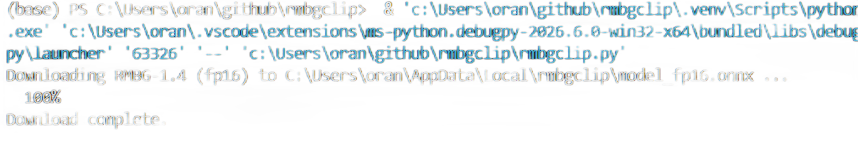
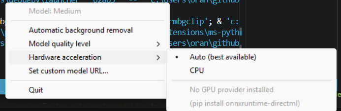

# rmbgclip
----
[](https://github.com/ellerbrock/open-source-badges/) [](https://opensource.org/licenses/MIT)


<!--  -->


<h2 align="center">____________________</h2>

<h4 align="center">________________________</h4>

---


# Installation
### 
```bash
cd ~
git clone https://github.com/wisehackermonkey/rmbgclip.git
cd rmbgclip
```

# Summary
### -  *[Installation](#Installation)*
<!-- ### -  *[Deveopment](#For-developers)* -->
<!-- ### -  *[Links](#Links)* -->
### -  *[Contributors](#Contributors)*
### -  *[License](#License)*


--------------
# Screenshots
-  


-------------- 
# Development
### 
```bash
pip install pyinstaller

mkdir models
curl -L -o models\model_fp16.onnx https://huggingface.co/briaai/RMBG-1.4/resolve/main/onnx/model_fp16.onnx

pyinstaller --noconfirm --onefile --windowed --name rmbgclip ^
  --add-data "models\model_fp16.onnx;models" ^
  --collect-all onnxruntime ^
  --hidden-import pystray._win32 ^
  --hidden-import win32clipboard ^
  rmbgclip.py
```
<!-- 

# Deployment to surge.sh
### 
```bash
bash deploy_to_surge_sh.sh
```

---
# Links
###
-->

--------------
# Contributors

[](https://github.com/wisehackermonkey/rmbgclip/graphs/contributors)

##### Made with [contributors-img](https://contrib.rocks).

--------------


# License

#### MIT © wisehackermonkey


[](https://opensource.org/licenses/MIT)
```bash
by oran collins
github.com/wisehackermonkey
oranbusiness@gmail.com
20261023
```

#### [More of my Projects](https://github.com/wisehackermonkey/)