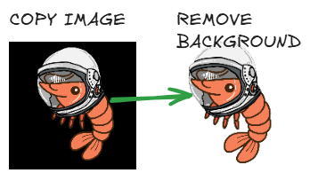
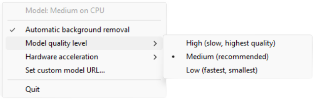

# rmbgclip
----
[](https://github.com/ellerbrock/open-source-badges/) [](https://opensource.org/licenses/MIT)





<h2 align="center">Removes background from images in your clipboard. fast and local!</h2>

<h4 align="center"> super great when using with photoshop or other creative work where its kinda annoying to remove backgrounds, this makes it AUTOMAGICLY </h4>
<h4 align="center">
WARNING this app contains SLOPWARE CODE, it works really well. just thought you should know before downloaded 😇</h4>

---


# Installation
# go to he 
### 
```bash
cd ~
git clone https://github.com/wisehackermonkey/rmbgclip.git
cd rmbgclip
```

# Summary
### -  *[Installation](#Installation)*
<!-- ### -  *[Deveopment](#For-developers)* -->
<!-- ### -  *[Links](#Links)* -->
### -  *[Contributors](#Contributors)*
### -  *[License](#License)*


--------------
# Screenshots
-  

# how to select model quality level


-------------- 
# Development
### 
```bash
pip install pyinstaller

mkdir models
curl -L -o models\model_fp16.onnx https://huggingface.co/briaai/RMBG-1.4/resolve/main/onnx/model_fp16.onnx

pyinstaller --noconfirm --onefile --windowed --name rmbgclip --add-data "models\model_fp16.onnx;models" --collect-all onnxruntime --hidden-import pystray._win32 --hidden-import win32clipboard rmbgclip.py
```
<!-- 

# Deployment to surge.sh
### 
```bash
bash deploy_to_surge_sh.sh
```

---
# Links
###
-->

# the slop prompted used
```

write a python script "rmbgclip" that reads when the windows clipboard has a image copied into clipboard

runs the image through RMBG-1.4
the copies the resulting image to the clipboard, and shows a windows notification "background removed sucessfully"

link to quantized version https://huggingface.co/briaai/RMBG-1.4/blob/main/onnx/model_fp16.onnx

add a windows tray. with options
"automatic remove background on off" prompts the user each time if off

"set custom rmbg model url"
"change model quality level"
high (slow, highest quality) https://huggingface.co/briaai/RMBG-1.4/blob/main/onnx/model.onnx
medium (recommended) https://huggingface.co/briaai/RMBG-1.4/blob/main/onnx/model_quantized.onnx
low https://huggingface.co/briaai/RMBG-1.4/blob/main/onnx/model_quantized.onnx

show optional GPU in the system try opions


write a command for PyInstaller (bundle the medium model inside the exe) one standalone exe

```
--------------
# Contributors

[](https://github.com/wisehackermonkey/rmbgclip/graphs/contributors)

##### Made with [contributors-img](https://contrib.rocks).

--------------


# License

#### MIT © wisehackermonkey


[](https://opensource.org/licenses/MIT)
```bash
by oran collins
github.com/wisehackermonkey
oranbusiness@gmail.com
20261023
```

#### [More of my Projects](https://github.com/wisehackermonkey/)